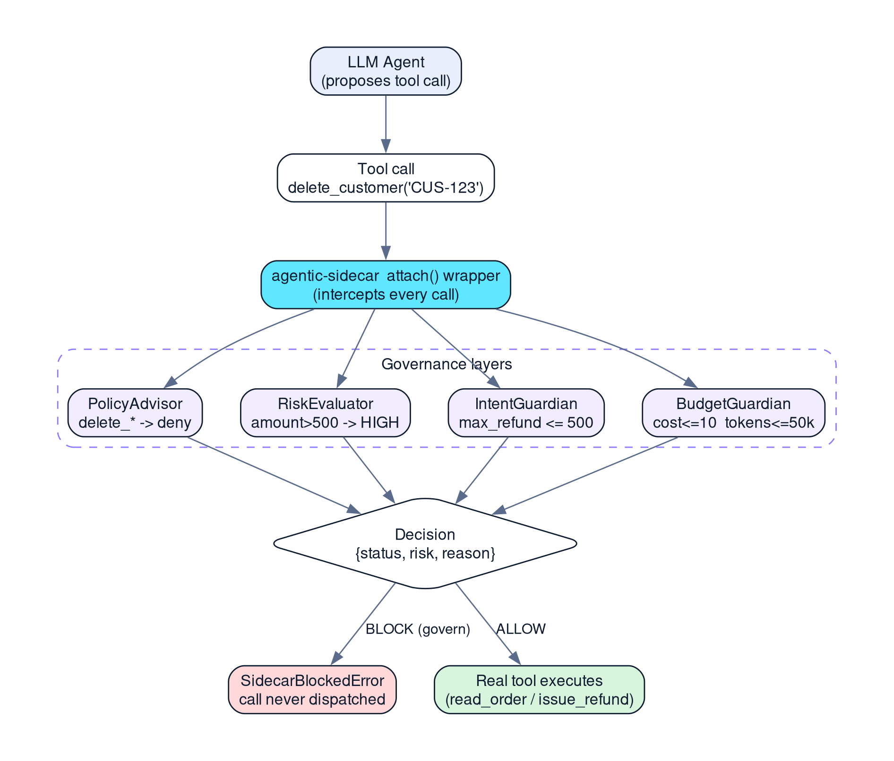

*Featured image: a Sidecar decision gate sits between the agent and its tools*

> **Key takeaways**
>
> - Instructions in a prompt are requests, not controls. Enforcement has to sit on the path where the tool call actually executes.
> - Agentic Sidecar 0.6.0 checks every governed call against policy, risk, intent and budget, in that order. The first layer to block decides.
> - In my demo, an order lookup and a 250 refund ran. A 750 refund and a customer deletion were stopped before the tool body executed.

> **🎮 Interactive version.** There is an animated, self-contained companion to this series that steps
> the request through the decision gate and lets you run the Observe-vs-Govern scenarios yourself. It is a
> plain static page (`blog_posts/demo/index.html`) — no build step, no network. Publish it as a link or an
> `<iframe>`; **Markdown-only platforms such as dev.to cannot run the JavaScript**, so on those use the link
> and keep the static figures below. See `blog_posts/demo/README.md` for hosting and embedding steps.

## Introduction

Give a language model a `delete_customer` tool and an `issue_refund` tool, and you have given it real authority. The model will usually behave. The question that matters in a support workflow is what happens on the day it does not: a misread request, a prompt injection hidden in a ticket, or a plain hallucinated argument.

I built this to test one claim: you can keep policy out of tool code and still stop an unsafe call. The claim holds, but the part that matters is not the rules. It is where they run. This is the customer-support agent I built during my internship at DeepAgentLabs: three plain functions, a LangGraph loop, and Agentic Sidecar 0.6.0 attached at the tool boundary. It uses a scripted agent, so it needs no API key and no network, and everything below is reproducible.

The agent can look up orders and issue refunds up to a limit. It cannot delete customers, and it cannot issue a refund above the amount its user authorized.

## The problem: instructions are not enforcement

The first instinct is to put the rules in the system prompt: never delete accounts, never refund more than 500. That is a request, not a control. The model may follow it, and nothing outside the model verifies that it did.

What a support operation needs is the same thing a payments system needs: a check that sits on the execution path and says no, regardless of what the model intended. That check has to be deterministic, has to fail safe if it breaks, and has to leave a record of what it decided and why.

## The solution: a decision gate at the tool boundary

Agentic Sidecar is a governance layer that runs alongside an agent. Instead of letting every proposed tool call execute, it evaluates the call first and returns a decision. In this project I used four of its layers:

- **Policy:** pattern rules on tool names. `read_*` is allowed, `delete_*` is denied.
- **Risk:** rates a call LOW or HIGH, here using an argument value (a refund above 500 is HIGH).
- **Intent:** compares the call against what the requester actually authorized (a maximum refund of 500).
- **Budget:** caps cost at $10.00 and tokens at 50,000.

The layers run in a fixed order: policy, then risk, then intent, then budget. Each one can return a decision immediately, so the first layer that blocks is the one whose reason you see. I confirmed this order by reading the 0.6.0 source, and it explains an odd detail in the logs later: a blocked deletion shows `risk=None`, because the policy layer decided before the risk layer ran.

The package defines a wider set of outcomes (ALLOW, WARN, BLOCK, CHALLENGE, REPLAN, PAUSE and ESCALATE). This demo exercises ALLOW and BLOCK.



*Figure 1: Request flow. The governed tool consults the Sidecar layers, in order, before the real function body runs.*

## Implementation

### 1. Plain business tools

The tools are ordinary Python functions. Each prints a marker when its body actually executes, which becomes important later when proving that a blocked call never ran.

*src/customer_support_agent.py (business tools)*

```text
def read_order(order_id: str) -> str:
    """Look up an order by ID."""
    print(f"    >>> TOOL EXECUTED: read_order({order_id})")
    return f"Order {order_id}: status=shipped, items=3"

def issue_refund(order_id: str, amount: float) -> str:
    """Issue a refund for an order."""
    print(f"    >>> TOOL EXECUTED: issue_refund({order_id}, amount={amount})")
    return f"Refund of {amount} issued for {order_id}"

def delete_customer(customer_id: str) -> str:
    """Delete a customer account."""
    print(f"    >>> TOOL EXECUTED: delete_customer({customer_id})")
    return f"Customer {customer_id} deleted"
```

### 2. Policy and risk

*Policy and risk rules*

```python
policy = PolicyAdvisor.from_mapping({
    "default": "allow",
    "rules": [
        {"tool": "delete_*", "effect": "deny",
         "reason": "Destructive operations require sign-off"},
        {"tool": "read_*", "effect": "allow"},
    ],
})

risk = RiskEvaluator.from_mapping({
    "default": "LOW",
    "rules": [
        {"tool": "issue_refund", "arg_name": "amount",
         "arg_op": "gt", "arg_value": 500, "risk": "HIGH"},
        {"tool": "delete_*", "risk": "HIGH"},
        {"tool": "read_*", "risk": "LOW"},
    ],
})
```

### 3. Intent and budget

Intent is the layer that is easiest to overlook. Policy says what a tool may do in general. Intent says what **this requester** authorized for **this task**. The envelope records the goal, the requester and the constraints. A binding then ties a constraint to a specific tool argument.

*Intent envelope, constraint binding and budget*

```python
envelope = IntentEnvelope(
    goal="Provide customer support and issue authorized refunds",
    requested_by=Requester(type="human", id="customer-support-user"),
    constraints={"max_refund_amount": 500.0},
    authority={"can_issue_refund": True},
    expires=None,
)

bindings = [ConstraintBinding(
    constraint="max_refund_amount", tool="issue_refund",
    arg_name="amount", op="lte", severity="BLOCK",
    reason="Refund exceeds the user's authorized maximum of 500",
)]

intent_guardian = IntentGuardian(envelope=envelope, bindings=bindings)
budget = BudgetGuardian(max_cost=10.0, max_tokens=50_000)
```

The operator is `lte`, so a refund of exactly 500 is allowed and 500.01 is not. That inclusive boundary is easy to get wrong, so I test it explicitly (covered in the third article of this series).

### 4. Assembling the Sidecar

*The Sidecar configuration*

```python
return Sidecar(
    on_sidecar_failure="fail_closed",
    policy=policy,
    risk=risk,
    intent=intent_guardian,
    budget=budget,
    mode="govern",
    risk_block_threshold="HIGH",
    roles=["policy", "risk", "intent_guardian", "budget"],
)
```

Two parameters deserve attention. `on_sidecar_failure="fail_closed"` means that if the governance layer itself errors, the tool call is not allowed through. `mode="govern"` means decisions are enforced. The second article in this series covers what `observe` mode does instead.

### 5. Wiring into LangGraph

*Governance is applied before the functions become LangChain tools*

```python
governed_functions = attach(sidecar, [read_order, issue_refund, delete_customer])
governed_tools = [tool(fn) for fn in governed_functions]
tool_node = ToolNode(governed_tools)

graph = StateGraph(AgentState)
graph.add_node("agent", scripted_agent)
graph.add_node("tools", tool_node)
graph.set_entry_point("agent")
graph.add_conditional_edges("agent", tools_condition,
                            {"tools": "tools", "__end__": "__end__"})
graph.add_edge("tools", "agent")
```

The order of operations matters. `attach()` wraps plain Python callables and returns governed versions. Only then do I wrap them with LangChain's `@tool`. Reversing that order fails, as described in the lessons below.

I used a deterministic scripted agent instead of a live model. That was a deliberate choice: it makes every run reproducible, so the demonstration tests the governance boundary and not the model's mood.

## Results

The demo runs four requests through the same governed graph. Output was captured on Python 3.14.8 with agentic-sidecar 0.6.0, using the dependency versions pinned in the project's requirements.txt.

| Request | Sidecar decision | What happened |
| --- | --- | --- |
| Look up order ORD-123 | ALLOW, risk LOW | `read_order` executed and returned the order. |
| Refund of 250 | ALLOW, risk LOW | `issue_refund` executed. |
| Refund of 750 | BLOCK, risk HIGH | `SidecarBlockedError` raised; `issue_refund` body never ran. |
| Delete customer CUS-123 | BLOCK | Policy denied it: "Destructive operations require sign-off"; body never ran. |

*Captured output, verbatim. The two [GOVERN] log lines appear first in the capture.*

```text
[GOVERN] BLOCK tool=issue_refund args={'order_id': 'ORD-123', 'amount': 750.0} risk=HIGH reason=Risk Evaluator: Matched risk rule tool='issue_refund' -> risk=HIGH (risk >= block threshold 'HIGH')
[GOVERN] BLOCK tool=delete_customer args={'customer_id': 'CUS-123'} risk=None reason=Policy Advisor: Destructive operations require sign-off
CUSTOMER SUPPORT AGENT
Agentic Sidecar + LangGraph

============================================================
SAFE ORDER LOOKUP
============================================================
User: Please look up order ORD-123
    >>> TOOL EXECUTED: read_order(ORD-123)
Final: Done. Tool result: Order ORD-123: status=shipped, items=3

Sidecar decisions:
  read_order: ALLOW | risk=LOW | Policy Advisor: Matched policy rule tool='read_*' -> effect=allow; Risk Evaluator: Matched risk rule tool='read_*' -> risk=LOW; Intent Guardian: No intent constraints violated for 'read_order'; Budget Guardian: 

============================================================
AUTHORIZED REFUND
============================================================
User: Please issue a refund of 250 for order ORD-123
    >>> TOOL EXECUTED: issue_refund(ORD-123, amount=250.0)
Final: Done. Tool result: Refund of 250.0 issued for ORD-123

Sidecar decisions:
  issue_refund: ALLOW | risk=LOW | Policy Advisor: No policy rule matched tool 'issue_refund'; default effect is 'allow'; Risk Evaluator: No risk rule matched tool 'issue_refund'; default risk is 'LOW'; Intent Guardian: No intent constraints violated for 'issue_refund'; Budget Guardian: 

============================================================
OVERSIZED REFUND
============================================================
User: Please issue a refund of 750 for order ORD-123
Execution stopped: SidecarBlockedError: Sidecar blocked 'issue_refund'({'order_id': 'ORD-123', 'amount': 750.0}): Risk Evaluator: Matched risk rule tool='issue_refund' -> risk=HIGH (risk >= block threshold 'HIGH')

Sidecar decisions:
  issue_refund: BLOCK | risk=HIGH | Risk Evaluator: Matched risk rule tool='issue_refund' -> risk=HIGH (risk >= block threshold 'HIGH')

============================================================
DESTRUCTIVE ACTION
============================================================
User: Please delete customer CUS-123
Execution stopped: SidecarBlockedError: Sidecar blocked 'delete_customer'({'customer_id': 'CUS-123'}): Policy Advisor: Destructive operations require sign-off

Sidecar decisions:
  delete_customer: BLOCK | risk=None | Policy Advisor: Destructive operations require sign-off
```

Two details in this output are worth understanding. First, the 750 refund was stopped by the **risk** layer (a refund above 500 is HIGH, and HIGH meets the block threshold). The intent binding would also reject it, but because risk runs first, intent never gets the chance. The third article in this series proves the intent layer separately. Second, the deletion shows `risk=None` because policy denied it before risk ran.

Notice that neither blocked case printed `TOOL EXECUTED`. The agent proposed the action, the gate refused it, and the underlying function was never entered. The full suite of 22 automated tests passes on the same code.

## Reproduce it

The project pins its dependencies in `requirements.txt`, including `agentic-sidecar==0.6.0`.

*Commands from the project README*

```bash
python -m venv .venv
source .venv/bin/activate
pip install -r requirements.txt
python src/customer_support_agent.py     # the four-case demo
pytest -v                                # the automated tests
```

## Challenges and lessons learned

Most of what I learned came from the places where the first example I tried did not match the installed 0.6.0 package. I resolved each one by reading the source and running it.

- **`attach()` wants plain functions.** Passing a `@tool`-decorated `StructuredTool` into `attach()` raises a `TypeError` during signature inspection. The fix is the order shown above: attach first, decorate second.
- **Imports live where the code is, not where the examples say.** `IntentGuardian` and `ConstraintBinding` are in `agentic_sidecar.intent.alignment`, while `IntentEnvelope` and `Requester` are in `agentic_sidecar.intent.envelope`.
- **`evaluate()` records; the adapter enforces.** Calling `sidecar.evaluate()` returns and stores a decision but never raises. `SidecarBlockedError` comes from the LangGraph adapter wrapper. A demo built on direct `evaluate()` calls shows decisions, not enforcement.
- **`create_react_agent` is deprecated** in LangGraph 1.2.11, so I built the graph from `StateGraph`, `ToolNode` and `tools_condition`.
- **A scripted agent can loop forever.** If the agent node always re-reads the first message, it re-proposes the same tool call after every tool result. The agent must inspect the last message: if it is a `ToolMessage`, return a final reply.

The bigger lesson is architectural. Put the control where actions happen, not where intentions are formed. Each layer answers a different question (may this tool run, how risky is this call, did the user authorize it, can we afford it), and keeping them separate makes each one explainable.

## Limitations

This is a controlled demonstration, not a production system. The agent is scripted, no real database or payment system is connected, the risk rules are static, budget invocations are recorded manually rather than inferred, and human escalation would need a custom handler. I did not benchmark latency, so I make no performance claims.

## Conclusion

An agent does not need unrestricted authority over every tool it can name. The same support agent handled a normal lookup and an authorized refund, and was stopped on an oversized refund and a destructive deletion, with a recorded reason for each decision.

Two things I would carry into a production version. Fail-closed is a trade, not a free win: when an evaluator raises, the call is refused, which is right for refunds and will look like a mystery outage if the rules are misconfigured. And the rules become a maintenance surface of their own. The 500 refund ceiling is enforced by a risk rule and an intent binding independently, so changing it means touching both and re-running the boundary tests. The seam held up; the upkeep is what I would budget for next. I would also connect a live model and measure the gate's overhead, which I have not done.

---

**Next in this series:** Observe vs Govern: A Safer Rollout Path for AI Agent Guardrails, which shows what changes when the same BLOCK decision is only recorded.

## References

1. Agentic Sidecar 0.6.0 on PyPI. <https://pypi.org/project/agentic-sidecar/0.6.0/>
2. Agentic Sidecar source repository. <https://github.com/DeepAgentLabs/agentic-sidecar>
3. Agentic Sidecar README at the v0.6.0 tag. <https://github.com/DeepAgentLabs/agentic-sidecar/blob/v0.6.0/README.md>
4. Agentic Sidecar use cases. <https://deepagentlabs.io/agentic-sidecar/usecases/>
5. Project code used in this article. <https://github.com/CHANDU-M05/agentic-sidecar--internship>
6. Captured demo and pytest output (Python 3.14.8). <https://github.com/CHANDU-M05/agentic-sidecar--internship/blob/main/evidence/demo_output.txt>
7. LangGraph overview (LangChain documentation). <https://docs.langchain.com/oss/python/langgraph/overview>
