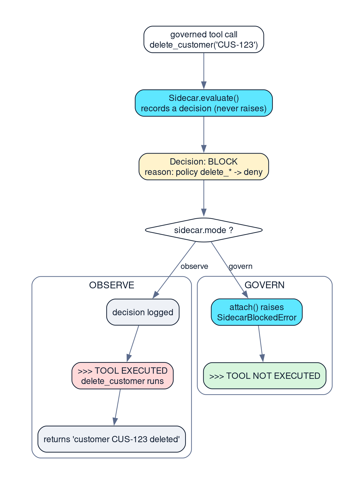

*Featured image: one decision, two possible outcomes*

> **Key takeaways**
>
> - Observe mode records a BLOCK and lets the tool run. Govern mode raises SidecarBlockedError before the tool body is entered.
> - Prove enforcement by asserting whether the function body ran, not by reading log text.
> - Govern mode enforces only BLOCK in 0.6.0. A budget PAUSE is recorded and the tool still runs.

> **🎮 Interactive simulator.** This article has a working companion where you pick a mode (Observe /
> Govern) and a scenario (read an order, refund exactly 500, refund 750, delete a customer), press Run, and
> watch the decision and the tool-execution indicator diverge by mode, with a step-by-step timeline and
> simulated terminal output. It is deterministic and **simulates** the verified 0.6.0 policy — it never issues
> a real refund or deletes anything. Open `blog_posts/demo/index.html` (tab 2) or host it and embed via
> `<iframe>`; Markdown-only platforms such as dev.to cannot run it, so link out and keep the captured logs
> below. Truth-table behavior is checked by `blog_posts/demo/tests/test_simulator_policy.py` against live 0.6.0.

## Introduction

When you add guardrails to an agent that already works, the risky part is the guardrail itself. A rule that is slightly too strict can block legitimate work, and you only learn that after users complain. Agentic Sidecar addresses this with two execution modes, **observe** and **govern**, selectable with one constructor argument.

Flipping the mode flag is one field. Working out exactly what that field enforces is the real job. This is the same agent from Part 1, run twice against the same policy configuration, once recording decisions and once enforcing them, with captured output for both. It also covers the edge where "govern" stops meaning "stopped".

## Problem statement

I wanted answers to two questions while building a governed support agent. First, if a policy says BLOCK, does the tool actually stop? Second, is there a safe way to see what a new policy would block before turning enforcement on?

A log line saying `BLOCK` does not answer the first question. It is a statement of intent by the gate, not evidence about the tool. The only reliable evidence is whether the tool's function body ran.

## How the two modes work



*Figure 1: The same BLOCK decision produces different consequences by mode.*

|  | Observe | Govern |
| --- | --- | --- |
| Decision computed | Yes | Yes |
| Decision recorded | Yes | Yes |
| Tool body executes on BLOCK | **Yes** | **No** |
| Exception raised | No | `SidecarBlockedError` |

In observe mode the Sidecar behaves like a flight recorder: it evaluates every call and keeps the decision, but the governed wrapper calls through regardless of the status. In govern mode the same wrapper raises `SidecarBlockedError` before the tool body is entered.

## Implementation: proving it with an execution tracker

The test uses a single deny rule on `delete_customer` and builds the Sidecar twice, once per mode. The tool appends to a list when its body runs, so the assertion is about behavior, not log text.

*tests/test_observe_vs_govern.py: one Sidecar factory, mode as the only variable*

```python
def make_deny_sidecar(mode: str) -> Sidecar:
    policy = PolicyAdvisor.from_mapping({
        "default": "allow",
        "rules": [{"tool": "delete_customer", "effect": "deny",
                   "reason": "Destructive operations require sign-off"}],
    })
    return Sidecar(on_sidecar_failure="fail_closed",
                   policy=policy, mode=mode, roles=["policy"])
```

*Observe: BLOCK is recorded, the tool still executes*

```python
def test_observe_mode_records_block_but_tool_still_executes():
    executed = []
    def delete_customer(customer_id: str) -> str:
        executed.append(customer_id)
        return f"deleted {customer_id}"

    sidecar = make_deny_sidecar("observe")
    [governed_delete] = attach(sidecar, [delete_customer])
    result = governed_delete(customer_id="CUS-123")      # no exception

    assert sidecar.decisions[0][1].status == "BLOCK"     # recorded
    assert executed == ["CUS-123"]                       # but it ran
```

*Govern: SidecarBlockedError is raised and the body is never entered*

```python
def test_govern_mode_raises_and_tool_does_not_execute():
    executed = []
    ...
    sidecar = make_deny_sidecar("govern")
    [governed_delete] = attach(sidecar, [delete_customer])

    with pytest.raises(SidecarBlockedError) as exc_info:
        governed_delete(customer_id="CUS-123")

    assert exc_info.value.decision.status == "BLOCK"
    assert executed == []                                # body never entered
```

The suite also checks that govern mode still lets a safe tool through, and that observe mode keeps recording decisions even though it never blocks. Those two tests guard against a mode that is accidentally too aggressive or too silent.

## Results

Running the same call in both modes produced this. Output was captured on Python 3.14.8 with agentic-sidecar 0.6.0, using the dependency versions pinned in the project's requirements.txt.

*Captured output from src/observe_vs_govern.py, verbatim. The two log lines print first.*

```text
[OBSERVE] BLOCK tool=delete_customer args={'customer_id': 'CUS-123'} risk=None reason=Policy Advisor: Destructive operations require sign-off
[GOVERN] BLOCK tool=delete_customer args={'customer_id': 'CUS-123'} risk=None reason=Policy Advisor: Destructive operations require sign-off

==================================================
  MODE: OBSERVE
==================================================
  Calling governed delete_customer(customer_id='CUS-123') ...
    >>> TOOL EXECUTED: delete_customer
  Tool returned: 'customer CUS-123 deleted'

  Decisions recorded by sidecar (1):
    tool=delete_customer  status=BLOCK  risk=None

==================================================
  MODE: GOVERN
==================================================
  Calling governed delete_customer(customer_id='CUS-123') ...
  SidecarBlockedError raised!
  Decision : BLOCK
  Risk     : None
  Reason   : Policy Advisor: Destructive operations require sign-off
    >>> TOOL NOT EXECUTED

  Decisions recorded by sidecar (1):
    tool=delete_customer  status=BLOCK  risk=None
```

The decision is identical in both runs. Only the consequence changes. In observe mode, the destructive tool ran even though the Sidecar had already judged it a BLOCK.

## A rollout pattern this suggests

The following is my own recommendation based on how the modes behave. I have not run it against production traffic.

- **Start in observe.** Attach the Sidecar to existing tools with the intended rules and leave `mode="observe"`. Behavior for users does not change.
- **Review the recorded decisions.** Every would-be BLOCK is in `sidecar.decisions` with its reason. Legitimate requests appearing there mean a rule needs adjusting.
- **Switch to govern.** Change the one `mode` argument once the recorded decisions match what you want blocked.
- **Keep `fail_closed`.** Decide deliberately whether a failure of the governance layer should stop tools, rather than inheriting a default.

## The same shape shows up with budgets

Observe mode is not the only place where a decision is recorded without being enforced. In 0.6.0 an exceeded budget produces a **PAUSE** decision, and the LangGraph adapter raises only for BLOCK. A test with the budget at its $10.00 ceiling and the Sidecar in **govern** mode shows the tool still executing, with a PAUSE recorded. The registered `on_escalation_required` hook is stored but, by my reading of the 0.6.0 source, never called.

This surprised me most: govern mode is narrower than its name suggests. It enforces exactly one status. Stopping on cost means checking `decision.escalation_required` in your own code.

Newer releases change this. In the 0.6.1 source, the LangGraph adapter routes govern-mode decisions through `Sidecar.enforce()`. There, PAUSE and ESCALATE go to a registered escalation handler and, with none registered, raise `SidecarSuspendedError` before the tool is dispatched. I checked this by reading the 0.6.0, 0.6.1 and 0.8.1 packages (`enforce()` and `SidecarSuspendedError` are absent in 0.6.0 and present from 0.6.1), but I did not run my own tests against the newer versions. The practical consequence is that an upgrade is more than a version bump: code that only catches `SidecarBlockedError` must handle `SidecarSuspendedError` as well.

## Lessons learned

- **A `BLOCK` log in observe mode is easy to misread.** In the captured output the `[OBSERVE] BLOCK` record prints at the top, and `>>> TOOL EXECUTED` appears a few lines later, inside the OBSERVE section. Anyone who stops reading at the BLOCK line could assume the call was stopped. Dashboards should show the mode next to the decision.
- **Enforcement lives in the adapter, not in `evaluate()`.** Reading the source showed that `evaluate()` only records and returns a decision, so a test built on it proves nothing about enforcement. The tests only became meaningful once they went through `attach()`.
- **Test behavior, not messages.** The `executed` list is a few lines of code and the strongest assertion in the suite.

## Limitations

The tools here are stubs, so "executed" means a Python function ran, not that a real customer was deleted. I did not measure the overhead of either mode.

## Conclusion

The rollout rule I would keep is the obvious one: run observe until the recorded decisions match what you actually want stopped, then switch. The rule I would add is to check what the switch covers. Govern stops BLOCK. A budget ceiling produces PAUSE, and at 0.6.0 that decision is recorded while the tool still runs, with the escalation hook stored and never called. On 0.6.0 you have to check `decision.escalation_required` in your own code. From 0.6.1 onward, `enforce()` raises `SidecarSuspendedError` and does it for you.

---

**Previous:** Governing a Customer-Support AI Agent at Runtime with Agentic Sidecar.  **Next:** Testing AI Agent Guardrails: How I Proved a Blocked Tool Never Ran.

## References

1. Agentic Sidecar 0.6.0 on PyPI. <https://pypi.org/project/agentic-sidecar/0.6.0/>
2. Agentic Sidecar source repository. <https://github.com/DeepAgentLabs/agentic-sidecar>
3. Agentic Sidecar README at the v0.6.0 tag. <https://github.com/DeepAgentLabs/agentic-sidecar/blob/v0.6.0/README.md>
4. Agentic Sidecar use cases. <https://deepagentlabs.io/agentic-sidecar/usecases/>
5. Project code used in this article. <https://github.com/CHANDU-M05/agentic-sidecar--internship>
6. Captured demo and pytest output (Python 3.14.8). <https://github.com/CHANDU-M05/agentic-sidecar--internship/blob/main/evidence/demo_output.txt>
7. LangGraph overview (LangChain documentation). <https://docs.langchain.com/oss/python/langgraph/overview>
