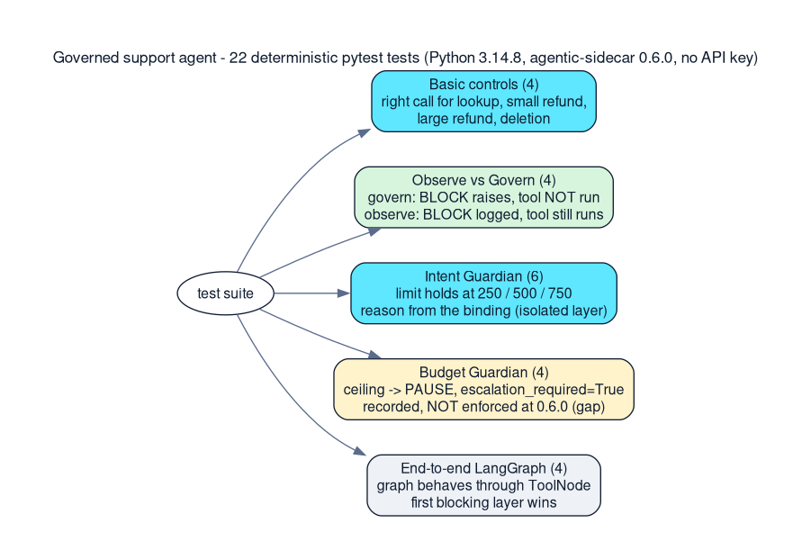

*Featured image: testing the decision gate*

> **Key takeaways**
>
> - Test the boundary value (500), not just the sides, and prove non-execution by recording whether the tool body ran.
> - Layers run in order and the first block wins, so an end-to-end test can pass for the wrong reason. Isolate each layer to prove it.
> - Test what every decision status does. In 0.6.0 a budget PAUSE is recorded but not enforced.

> **🎮 Interactive companion.** The whole series has an animated, self-contained demo page
> (`blog_posts/demo/index.html`) with the tool-boundary flow, the LangGraph loop, and an Observe-vs-Govern
> simulator whose truth table is checked against live 0.6.0 by `blog_posts/demo/tests/test_simulator_policy.py`.
> Markdown-only platforms such as dev.to cannot run it; link out or embed via `<iframe>` (see the demo README).

## Introduction

A guardrail that has never been tested is a hope. My governed support agent has policy, risk, intent and budget controls, and the question I cared about was simple: how do I know each one works, and works for the reason I think it does?

The oversized refund in my end-to-end test never reaches the intent layer. Risk stops it first, because the layers run in order and the first block returns. That is correct behavior and a nearly useless test for the intent layer. An end-to-end pass proves the pipeline works, not that each layer does. So the suite tests the edges in isolation as well as the wired graph: 22 tests, deterministic, no API key, and one written to catch enforcement I had assumed existed.

## Problem statement

Agent tests are awkward for three reasons. Language models are not deterministic, so a test that depends on one is flaky. A passing test can hide the wrong cause. And the most important claim, that a blocked tool did not run, is about something not happening, which is harder to assert than something happening.

## Test architecture



*Figure 1: The five groups of tests and what each proves. Cyan = decision proven; green = blocked and prevented (govern) vs recorded but ran (observe); amber = the enforcement gap the budget tests exposed; gray = the wired end-to-end graph.*

| Group | Tests | Question it answers |
| --- | --- | --- |
| Basic controls | 4 | Do policy and risk reach the right decision for lookup, small refund, large refund and deletion? |
| Observe vs Govern | 4 | Is a BLOCK enforced in govern mode and only recorded in observe mode? |
| Intent Guardian | 6 | Does the authorized limit hold at 250, 500 and 750, with the right reason? |
| Budget Guardian | 4 | What decision does an exceeded cost or token ceiling produce, and does govern mode stop the tool? |
| End-to-end LangGraph | 4 | Does the whole graph behave correctly through `ToolNode`? |

## Technique 1: remove the model

The end-to-end tests use a deterministic scripted agent that proposes a fixed tool call based on keywords in the request. This means a failure points at the governance boundary, not at model variance. It also needed one fix: the agent must check whether the last message is a `ToolMessage` and stop, otherwise it re-proposes the same tool call forever.

## Technique 2: test the boundary, not just the sides

The refund limit is 500, expressed with the `lte` operator. Testing 250 and 750 would pass even if the operator were `lt`. So the suite includes the exact limit.

*tests/test_intent_guardian.py (condensed)*

```python
def test_refund_below_limit_is_allowed():      # 250
    assert evaluate(create_sidecar(), 250).status == "ALLOW"

def test_refund_at_exact_limit_is_allowed():    # 500, the boundary
    assert evaluate(create_sidecar(), 500).status == "ALLOW"

def test_refund_above_limit_is_blocked():       # 750
    assert evaluate(create_sidecar(), 750).status == "BLOCK"
```

## Technique 3: isolate each layer

This is the finding I did not expect. Look at the end-to-end output for the 750 refund:

*End-to-end run: the 750 refund is stopped, but by which layer?*

```text
[GOVERN] BLOCK tool=issue_refund args={'order_id': 'ORD-123', 'amount': 750.0}
  risk=HIGH reason=Risk Evaluator: Matched risk rule tool='issue_refund'
  -> risk=HIGH (risk >= block threshold 'HIGH')
```

The reported reason is the **Risk Evaluator**. The Sidecar evaluates its layers in a fixed order (policy, risk, intent, budget) and returns as soon as one blocks. I confirmed this order in the 0.6.0 source. The risk rule (above 500 is HIGH) fires first, so the intent binding (amount at most 500) is never evaluated in this run. The end-to-end test would therefore still pass if the intent binding were misconfigured or missing.

That is why the Intent Guardian tests build a Sidecar with only that layer enabled (`roles=["intent_guardian"]`):

*Isolating the intent layer*

```python
return Sidecar(
    on_sidecar_failure="fail_closed",
    intent=IntentGuardian(envelope=envelope, bindings=bindings),
    mode="govern",
    roles=["intent_guardian"],     # no policy, no risk
)
```

*With only intent enabled, the block comes from the intent layer*

```text
[GOVERN] BLOCK tool=issue_refund args={'order_id': 'ORD-123', 'amount': 750}
  risk=None reason=Intent Guardian: Refund exceeds the user's authorized maximum of 500
```

Overlapping layers are good defense in depth, but they make end-to-end tests poor evidence for any single layer. Isolated tests prove each layer independently. End-to-end tests prove the wiring.

## Technique 4: assert non-execution directly

For the claim that a blocked tool never ran, the observe/govern tests append to a list inside the tool body and assert on it, as described in the previous article. The same idea appears in the demo output as `TOOL EXECUTED` markers, which are absent for both blocked cases.

## Results

*pytest -v output from my own run (Python 3.14.8, agentic-sidecar 0.6.0, progress percentages removed for width)*

```text
$ pytest -v
platform linux -- Python 3.14.8, pytest-9.1.1, pluggy-1.6.0
collected 22 items
tests/test_budget_guardian.py::test_under_budget_is_allowed PASSED
tests/test_budget_guardian.py::test_cost_limit_exceeded_pauses_for_escalation PASSED
tests/test_budget_guardian.py::test_token_limit_exceeded_pauses_for_escalation PASSED
tests/test_budget_guardian.py::test_govern_mode_does_not_stop_over_budget_tool PASSED
tests/test_customer_support_agent.py::test_safe_order_lookup_is_allowed PASSED
tests/test_customer_support_agent.py::test_authorized_refund_is_allowed PASSED
tests/test_customer_support_agent.py::test_oversized_refund_is_blocked PASSED
tests/test_customer_support_agent.py::test_customer_deletion_is_blocked PASSED
tests/test_intent_guardian.py::test_refund_below_limit_is_allowed PASSED
tests/test_intent_guardian.py::test_refund_at_exact_limit_is_allowed PASSED
tests/test_intent_guardian.py::test_refund_above_limit_is_blocked PASSED
tests/test_intent_guardian.py::test_block_reason_is_from_binding PASSED
tests/test_intent_guardian.py::test_intent_guardian_is_independent_of_policy PASSED
tests/test_intent_guardian.py::test_different_tool_is_not_constrained PASSED
tests/test_observe_vs_govern.py::test_observe_mode_records_block_but_tool_still_executes PASSED
tests/test_observe_vs_govern.py::test_govern_mode_raises_and_tool_does_not_execute PASSED
tests/test_observe_vs_govern.py::test_govern_mode_allows_safe_tool PASSED
tests/test_observe_vs_govern.py::test_observe_mode_decision_is_still_recorded PASSED
tests/test_sidecar_controls.py::test_safe_order_lookup_is_allowed PASSED
tests/test_sidecar_controls.py::test_small_refund_is_allowed PASSED
tests/test_sidecar_controls.py::test_large_refund_is_blocked PASSED
tests/test_sidecar_controls.py::test_customer_deletion_is_blocked PASSED
============================== 22 passed in 0.37s ==============================
```

The 0.37 seconds is the runtime of the test suite on my machine, not a measurement of the Sidecar's per-call overhead. I have not benchmarked that.

## The budget tests exposed a gap in enforcement

The last group of tests started as a way to cover the $10.00 and 50,000-token budget. They found something more useful than a green result. When a ceiling is reached, the Budget Guardian does not return BLOCK. It returns **PAUSE** with `escalation_required=True`.

In 0.6.0 the LangGraph adapter raises `SidecarBlockedError` only when the status is BLOCK. So in govern mode an over-budget call is recorded as PAUSE and the tool still runs. The test that pins this down is deliberately written to describe the behavior, not the behavior I wished for:

*tests/test_budget_guardian.py (docstring omitted): PAUSE is recorded, the tool still executes, the hook never fires*

```python
def test_govern_mode_does_not_stop_over_budget_tool():
    executed = []
    escalations = []

    def read_order(order_id: str) -> str:
        executed.append(order_id)
        return f"order {order_id}"

    budget = BudgetGuardian(max_cost=10.0, max_tokens=50_000)
    budget.record_invocation(cost=10.0)
    sidecar = make_budget_sidecar(budget, mode="govern")

    @sidecar.on_escalation_required
    def handle_escalation(request):
        escalations.append(request)

    [governed_read] = attach(sidecar, [read_order])

    # No exception: the PAUSE verdict does not stop dispatch
    result = governed_read(order_id="ORD-123")

    assert result == "order ORD-123"
    assert executed == ["ORD-123"]

    _ctx, decision = sidecar.decisions[0]
    assert decision.status == "PAUSE"
    assert decision.escalation_required is True

    # The escalation hook is stored but never called at 0.6.0
    assert escalations == []
```

Stopping on cost therefore needs the caller to check `decision.escalation_required` itself. This is specific to 0.6.0 and should be re-checked on any newer release. The lesson generalizes: do not assume every non-ALLOW decision is enforced. Write a test that proves what each status actually does.

## What the tests do not cover

- **A real model.** The scripted agent proves the boundary, not how a live model behaves under it.
- **Latency and concurrency.** Neither was measured.
- **Escalation.** There is no human-approval flow in this project. In 0.6.0 the `on_escalation_required` hook is stored but, by my reading of the source, never called, so registering one would not stop a paused call.

## Lessons learned

- A passing end-to-end test can be right for the wrong reason. Because the first blocking layer wins, read the decision reason, not just the status.
- A test that passes on one release says nothing about another. Budget enforcement changes at 0.6.1, where `Sidecar.enforce()` first appears, so label tests with the version they were verified against.
- Test the boundary value, because the operator is part of the behavior.
- Check that something did not happen by recording whether it happened.
- Be explicit about what is untested. A list of gaps is more useful than a green checkmark.

## Conclusion

The tests that earned their place were the boring edge ones: 500 allowed, 750 blocked, and the exact-limit case that a range check usually gets wrong. The most interesting one is the budget test, because it asserts the opposite of what I expected. An over-budget call is recorded as PAUSE and still executes at 0.6.0. It documents a limitation rather than a feature, and it is the one I would keep if I could keep only one, because it stopped me claiming the demo was fully governed.

---

**Previous:** Observe vs Govern: A Safer Rollout Path for AI Agent Guardrails.

## References

1. Agentic Sidecar 0.6.0 on PyPI. <https://pypi.org/project/agentic-sidecar/0.6.0/>
2. Agentic Sidecar source repository. <https://github.com/DeepAgentLabs/agentic-sidecar>
3. Agentic Sidecar README at the v0.6.0 tag. <https://github.com/DeepAgentLabs/agentic-sidecar/blob/v0.6.0/README.md>
4. Agentic Sidecar use cases. <https://deepagentlabs.io/agentic-sidecar/usecases/>
5. Project code used in this article. <https://github.com/CHANDU-M05/agentic-sidecar--internship>
6. Captured demo and pytest output (Python 3.14.8). <https://github.com/CHANDU-M05/agentic-sidecar--internship/blob/main/evidence/demo_output.txt>
7. LangGraph overview (LangChain documentation). <https://docs.langchain.com/oss/python/langgraph/overview>
